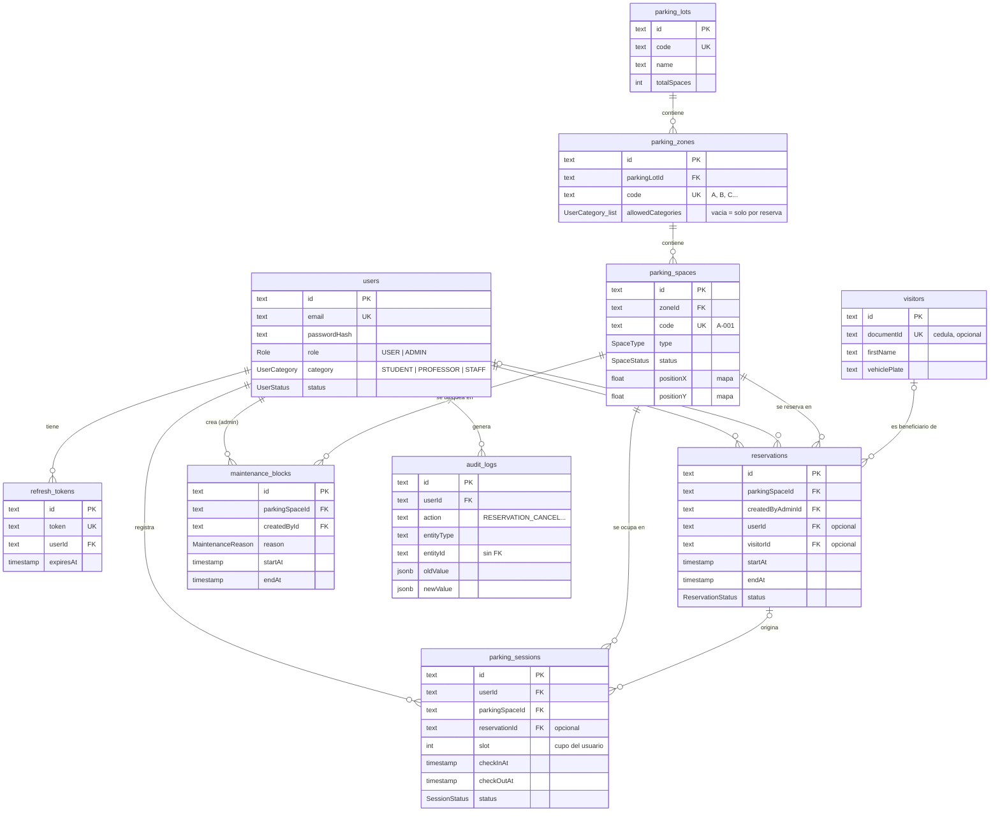

# Modelo de datos — UJAP Parking

Laboratorio de la Semana 11–12: el corazón de datos del proyecto.

| Archivo | Qué es |
|---|---|
| [`diagrama-er.dbml`](diagrama-er.dbml) | Diagrama entidad-relación completo (10 entidades). Pegarlo en [dbdiagram.io](https://dbdiagram.io/d) para verlo dibujado. |
| [`schema.sql`](schema.sql) | `CREATE TABLE` de las 10 entidades con PRIMARY KEY, FOREIGN KEY y las reglas de negocio que aplica PostgreSQL. |
| [`bonus-nosql.md`](bonus-nosql.md) | Bonus: la bitácora de auditoría modelada como documento de MongoDB. |

La fuente de verdad del esquema sigue siendo
[`backend/prisma/schema.prisma`](../../backend/prisma/schema.prisma); estos
archivos lo describen, no lo reemplazan.

---

## 1. Diagrama entidad-relación

Atributos clave de cada entidad. El detalle completo (todos los campos,
tipos y valores por defecto) está en `diagrama-er.dbml`.



### Las entidades

| Entidad | Qué representa |
|---|---|
| `users` | Miembros de la UJAP y administradores. `role` decide **qué** puede hacer; `category` decide **dónde** puede estacionarse. |
| `refresh_tokens` | Tokens de refresco del JWT de cada usuario. |
| `parking_lots` | Estacionamientos del campus. |
| `parking_zones` | Zonas de un estacionamiento (A–J), con las categorías que pueden usarlas. |
| `parking_spaces` | Cada uno de los 1.000 puestos, con su posición en el mapa. |
| `parking_sessions` | "El usuario X dejó el carro en el puesto Y desde las HH:MM". |
| `reservations` | Reserva administrativa de un puesto en un intervalo de tiempo. |
| `visitors` | Personas externas, que entran por reserva y no tienen cuenta. |
| `maintenance_blocks` | Bloqueo temporal de un puesto (pintura, obra, evento...). |
| `audit_logs` | Bitácora de toda escritura hecha en el sistema. |

### Las relaciones

| Relación | Tipo | Al borrar el padre |
|---|---|---|
| `parking_lots` → `parking_zones` | 1 : N | RESTRICT |
| `parking_zones` → `parking_spaces` | 1 : N | RESTRICT |
| `users` → `refresh_tokens` | 1 : N | CASCADE |
| `users` → `parking_sessions` | 1 : N | RESTRICT |
| `parking_spaces` → `parking_sessions` | 1 : N | RESTRICT |
| `reservations` → `parking_sessions` | 1 : N, opcional | SET NULL |
| `parking_spaces` → `reservations` | 1 : N | RESTRICT |
| `users` (admin que crea) → `reservations` | 1 : N | RESTRICT |
| `users` (beneficiario) → `reservations` | 1 : N, opcional | SET NULL |
| `visitors` → `reservations` | 1 : N, opcional | SET NULL |
| `parking_spaces` → `maintenance_blocks` | 1 : N | RESTRICT |
| `users` (admin que crea) → `maintenance_blocks` | 1 : N | RESTRICT |
| `users` → `audit_logs` | 1 : N | RESTRICT |

**Relación muchos a muchos:** un usuario se estaciona en muchos puestos a lo
largo del tiempo y un puesto recibe a muchos usuarios. `parking_sessions` es la
**tabla intermedia** de esa relación N:M, con datos propios (hora de entrada,
salida, estado).

**`users` aparece dos veces en `reservations`:** una como el administrador que
la crea (obligatorio) y otra como el beneficiario (opcional). Son dos FOREIGN
KEY distintas a la misma tabla.

### Reglas que aplica la base de datos, no la aplicación

| Regla | Cómo se aplica |
|---|---|
| RN-001: un puesto no tiene dos carros a la vez | Índice único parcial sobre `parkingSpaceId` `WHERE status = 'ACTIVE'` |
| RN-002: tope de sesiones activas por usuario | Índice único parcial sobre `(userId, slot)` `WHERE status = 'ACTIVE'` |
| RN-006: dos reservas vigentes de un puesto no se solapan | `EXCLUDE USING gist` con `tsrange(startAt, endAt, '[)')` |
| Una reserva termina después de empezar | `CHECK ("endAt" > "startAt")` |

Si se comprobaran con un `SELECT` antes del `INSERT`, dos peticiones
simultáneas podrían ver el puesto libre y ocuparlo las dos. Con estas
restricciones, la segunda inserción falla siempre.

---

## 2. Script SQL

[`schema.sql`](schema.sql) crea las 10 tablas en orden de dependencia, con sus
PRIMARY KEY, FOREIGN KEY, UNIQUE, CHECK, los índices parciales y la
restricción EXCLUDE. Se probó en PostgreSQL 16 sobre una base vacía:

- se crean las 10 tablas y las 13 FOREIGN KEY;
- se aceptan dos reservas consecutivas (08:00–10:00 y 10:00–12:00);
- se rechazan, cada una con su restricción: una FK a una zona inexistente, dos
  sesiones activas en un puesto, dos sesiones activas en el mismo cupo, dos
  reservas solapadas, una reserva que termina antes de empezar y el borrado de
  un estacionamiento que todavía tiene zonas.

```bash
createdb ujap_parking_demo
psql -d ujap_parking_demo -f docs/modelo-de-datos/schema.sql
```

---

## 3. Lectura: Prisma y Sequelize

Los dos son **ORM** (Object-Relational Mapping) para Node.js: permiten leer
y escribir la base de datos con objetos de JavaScript/TypeScript en lugar de
escribir SQL a mano.

### Prisma, el que usa este proyecto

- El modelo se escribe en un archivo propio, `schema.prisma`, con su propio
  lenguaje.
- `prisma migrate` compara ese archivo con la base y genera la migración SQL.
- `prisma generate` crea un cliente **con tipos de TypeScript generados del
  esquema**: si se escribe mal el nombre de un campo, el error sale al compilar.

```ts
// Puestos libres de la zona A, con su zona incluida
const spaces = await prisma.parkingSpace.findMany({
  where: { status: 'AVAILABLE', zone: { code: 'A' } },
  include: { zone: true },
});
```

### Sequelize

- Más antiguo (2010) y muy extendido. El modelo se define **en código**,
  con clases o con `sequelize.define()`.
- Las relaciones se declaran con métodos: `hasMany`, `belongsTo`,
  `belongsToMany`.
- Soporta TypeScript, pero los tipos se escriben a mano. No se generan del
  esquema.

```js
const ParkingSpace = sequelize.define('ParkingSpace', {
  id:     { type: DataTypes.UUID, primaryKey: true, defaultValue: DataTypes.UUIDV4 },
  code:   { type: DataTypes.STRING, unique: true, allowNull: false },
  status: { type: DataTypes.ENUM('AVAILABLE', 'OCCUPIED', 'RESERVED', 'DISABLED', 'MAINTENANCE') },
}, { tableName: 'parking_spaces' });

ParkingZone.hasMany(ParkingSpace, { foreignKey: 'zoneId' });
ParkingSpace.belongsTo(ParkingZone, { foreignKey: 'zoneId' });

const spaces = await ParkingSpace.findAll({
  where: { status: 'AVAILABLE' },
  include: { model: ParkingZone, where: { code: 'A' } },
});
```

### Comparación rápida

| | Prisma | Sequelize |
|---|---|---|
| Dónde se define el modelo | `schema.prisma` (archivo aparte) | En el código JS/TS |
| Tipos de TypeScript | Generados automáticamente | Escritos a mano |
| Migraciones | Se generan comparando el esquema | Se escriben a mano (o con `sync`) |
| Relaciones | Declaradas en el esquema | `hasMany`, `belongsTo`... |
| SQL que no sabe expresar | `$queryRaw` y migraciones editadas a mano | `sequelize.query()` |
| Bases soportadas | PostgreSQL, MySQL, SQLite, SQL Server, MongoDB... | PostgreSQL, MySQL, MariaDB, SQLite, SQL Server... |

**El límite de cualquier ORM, visto en este proyecto:** Prisma no sabe
expresar índices parciales, restricciones `EXCLUDE` ni `CHECK`. Por eso
existen las migraciones `..._active_session_partial_unique_indexes`,
`..._reservation_no_overlap_exclusion` y `..._session_slots`, escritas a mano
en SQL. Un ORM facilita el 90 % del trabajo, pero hay que saber SQL para el
resto.
